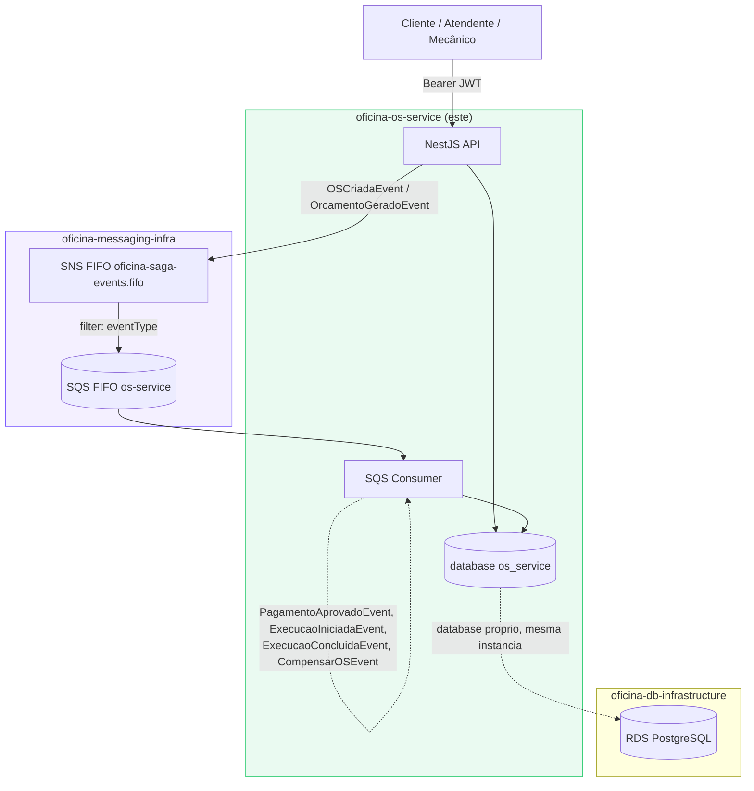

# oficina-os-service

Primeiro microsserviço extraído do monolito `oficina-app` (NestJS, Clean
Architecture/DDD) na Fase 4 do Tech Challenge. Dono exclusivo das Ordens de
Serviço — nenhum outro serviço acessa o banco deste microsserviço
diretamente. Participa do Saga Pattern coreografado publicando/consumindo
eventos via a infraestrutura de mensageria do `oficina-messaging-infra`.

| Repositório | Papel |
|---|---|
| [oficina-messaging-infra](https://github.com/marcosrenansilvafaria-afk/oficina-messaging-infra) | Broker SNS/SQS FIFO + contratos de evento do Saga |
| [oficina-db-infrastructure](https://github.com/marcosrenansilvafaria-afk/oficina-db-infrastructure) | RDS PostgreSQL compartilhada (este serviço usa um database próprio nela) |
| [oficina-k8s-infrastructure](https://github.com/marcosrenansilvafaria-afk/oficina-k8s-infrastructure) | Cluster EKS (destruído no momento — ver seção Deploy) |
| **oficina-os-service** (este) | Microsserviço de Ordem de Serviço |
| oficina-app | Monolito original da Fase 2/3 — ainda em operação, não afetado por esta sprint |

## Sumário

- [Propósito](#propósito)
- [Arquitetura](#arquitetura)
- [Saga Pattern — publica e consome](#saga-pattern--publica-e-consome)
- [Banco de dados](#banco-de-dados)
- [Execução local](#execução-local)
- [Swagger / OpenAPI](#swagger--openapi)
- [Testes e cobertura](#testes-e-cobertura)
- [Qualidade de código (SonarQube)](#qualidade-de-código-sonarqube)
- [Deploy no EKS](#deploy-no-eks)
- [Variáveis de ambiente](#variáveis-de-ambiente)
- [Limitações conhecidas](#limitações-conhecidas)

## Propósito

Gerenciar o ciclo de vida da Ordem de Serviço (cliente, veículo, catálogo de
serviços/peças, itens, orçamento, histórico de status) e reagir às decisões
dos demais microsserviços (pagamento aprovado/recusado, execução
iniciada/concluída) via eventos assíncronos — sem nenhuma chamada HTTP
direta a Billing ou Execution Service.

## Arquitetura



## Saga Pattern — publica e consome

Ver [SAGA_PATTERN_SPEC.md](https://github.com/marcosrenansilvafaria-afk/oficina-app/blob/main/docs/SAGA_PATTERN_SPEC.md)
para o desenho completo do Saga coreografado.

**Publica** (`infraestructure/saga/sns-publisher.service.ts`, SNS FIFO):
- `OSCriadaEvent` — ao criar a OS (`POST /os`).
- `OrcamentoGeradoEvent` — ao gerar o orçamento (`POST /os/:id/orcamento`).

**Consome** (`infraestructure/saga/sqs-consumer.service.ts`, long-polling na
fila FIFO deste serviço):

| Evento | Ação |
|---|---|
| `PagamentoAprovadoEvent` | `AprovarOrcamento` → status `APROVADA` |
| `ExecucaoIniciadaEvent` | `IniciarExecucao` → status `EM_EXECUCAO` |
| `ExecucaoConcluidaEvent` | `FinalizarOrdemServico` → status `FINALIZADA` |
| `CompensarOSEvent` (`origemFalha=PAGAMENTO`) | `CompensarOrdemServico` → volta para `EM_DIAGNOSTICO` |
| `CompensarOSEvent` (`origemFalha=EXECUCAO`) | `CompensarOrdemServico` → status terminal `CANCELADA` (novo) |

Cada evento consumido reaproveita a **mesma use-case** que a rota HTTP
equivalente usaria — a reação a um evento do Saga é tratada exatamente como
a ação que um humano faria via API.

Sem `SAGA_TOPIC_ARN`/`SAGA_QUEUE_URL` configurados (ex: `docker-compose`
local), o publisher fica no-op e o consumidor fica desabilitado — a API
funciona normalmente, só sem o lado assíncrono.

## Banco de dados

Este serviço usa um **database PostgreSQL próprio** (`os_service`) na mesma
instância RDS do `oficina-db-infrastructure` — não uma instância nova
(decisão de custo), mas isolado por um usuário dedicado sem acesso a nenhum
outro database da instância.

**Pendência conhecida**: a RDS é privada (sem rota desde a internet); o
bootstrap (`CREATE DATABASE os_service` + usuário dedicado) só pode ser
executado de dentro da VPC. Como o EKS (Repositório 3) está destruído no
momento, esse bootstrap ainda não foi executado — ver
[`scripts/bootstrap-database.sql`](scripts/bootstrap-database.sql) para o
script e instruções completas. Até lá, desenvolvimento e CI usam o Postgres
local do `docker-compose` normalmente.

## Execução local

```bash
docker-compose up --build
```

Sobe um Postgres local (porta `5433`, para não colidir com o do
`oficina-app`) + a API em `http://localhost:3001`. Migrations rodam
automaticamente no boot.

## Swagger / OpenAPI

`http://localhost:3001/docs`.

## Testes e cobertura

```bash
npm test                  # unitarios (Jest)
npm run test:cov:critical # cobertura de domain/entities + application/use-cases, gate >= 80%
npm run test:bdd          # BDD (jest-cucumber) - ciclo de vida completo da OS
npm run test:e2e          # end-to-end (supertest)
```

Evidência de cobertura atual (`test:cov:critical`): **98,38%** statements /
**92,3%** branches / **100%** functions / **98,93%** lines — acima do
mínimo de 80% exigido, cobrindo `domain/entities` e
`application/use-cases` (inclui `compensarExecucao()` e
`CompensarOrdemServico`, novos nesta sprint).

BDD (`test/bdd/ciclo-vida-ordem-servico.feature`, 3 cenários): fluxo feliz
completo (criação → diagnóstico → orçamento → `PagamentoAprovadoEvent` →
`ExecucaoIniciadaEvent` → `ExecucaoConcluidaEvent`) e os dois cenários de
compensação (`CompensarOSEvent` por `PAGAMENTO` e por `EXECUCAO`).

Controllers são exercitados pela suíte `test:e2e` (todas as rotas HTTP,
incluindo as duas que agora publicam eventos do Saga) — não estão
incluídos no gate de 80% de `test:cov:critical`, mesmo critério já adotado
no `oficina-app`.

## Qualidade de código (SonarQube)

`sonar-project.properties` já configurado (projectKey `oficina-os-service`).
**Pendência**: ainda não existe conta/organização SonarCloud criada para
este projeto. O job `sonarqube` do CI só executa quando a variável de
repositório `SONAR_ENABLED=true` for definida (após os secrets
`SONAR_TOKEN`/`SONAR_HOST_URL` existirem) — até lá, aparece como
**skipped**, nunca **failed**.

## Deploy no EKS

Pipeline em [`.github/workflows/ci-cd-os-service.yml`](.github/workflows/ci-cd-os-service.yml):
`lint-test` (lint, build, unit, cobertura ≥80%, BDD) → `sonarqube`
(condicional) → `docker-build-push` (GHCR) → `deploy` (condicional).

**Pendência**: o cluster EKS (Repositório 3) foi destruído ao final da
Fase 3 para eliminar custo ocioso. O job `deploy` só executa quando a
variável de repositório `EKS_DEPLOY_ENABLED=true` for definida — até o
cluster ser recriado, aparece como **skipped**, mantendo a pipeline verde.

### Configuração necessária no GitHub (quando o deploy for habilitado)

- **Secrets**: `AWS_ROLE_ARN`, `DB_HOST`, `DB_PORT`, `DB_NAME` (`os_service`),
  `DATABASE_URL`, `JWT_SECRET` (**idêntico** ao dos outros serviços — mesmo
  segredo compartilhado desde a Fase 3), `SAGA_TOPIC_ARN`, `SAGA_QUEUE_URL`
  (outputs do `oficina-messaging-infra`).
- Nova EKS Access Entry no Repositório 3 para a IAM Role deste repositório
  (mesmo padrão das demais, escopada ao namespace `oficina`).
- Variáveis de repositório `EKS_DEPLOY_ENABLED` e `SONAR_ENABLED`.
- Branch protection + Environment `production`, mesmo padrão dos demais
  repositórios.

## Variáveis de ambiente

Ver [`.env.example`](.env.example). Além das já existentes no `oficina-app`:
`SAGA_TOPIC_ARN`, `SAGA_QUEUE_URL`, `AWS_REGION` (vazios = Saga desabilitado,
ok para dev local).

## Limitações conhecidas

- `scripts/bootstrap-database.sql` ainda não foi executado contra a RDS
  real (ver seção "Banco de dados") — depende do EKS existir de novo.
- Conta SonarCloud ainda não criada — scan de qualidade configurado mas não
  executado de verdade ainda.
- `oficina-app` (monolito) continua em operação em paralelo; o cutover de
  tráfego real para este microsserviço é uma decisão de sprint futura.
